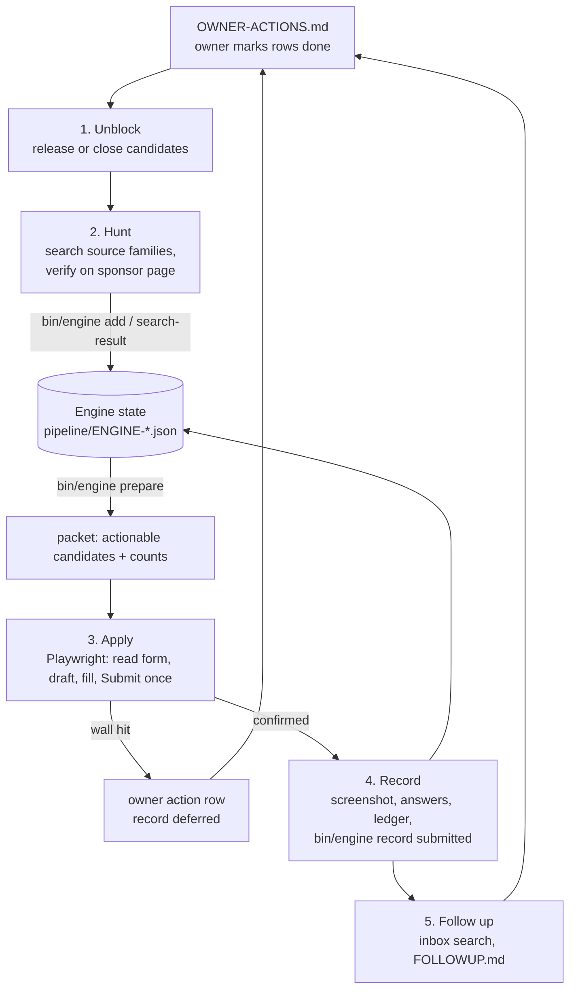

# Grants Hunter Agent

A Claude Code agent that finds grants, pitch competitions, accelerators and founder fellowships a small business actually qualifies for, writes the applications from a fact sheet, submits the fee-less ones, and tracks the replies, stopping only at the steps a human has to do.

## Why

Small-business funding is a long tail of programs, each with its own deadline, eligibility rules and form. Doing it by hand means re-checking the same programs and re-typing the same answers. Letting an AI do it unsupervised risks worse things: paying an "application fee" to a scam, inventing revenue numbers, applying twice, or claiming a submission that never went through.

This agent splits the work in two:
- **The model** searches, reads official rules, drafts answers and drives the browser.
- **A deterministic engine** (`engine/opportunity_engine.py`, no network, no model) owns the queue: dedupe, state, and the evidence each state change needs. A program can't be marked submitted without a screenshot and the portal's confirmation text, and an uncertain click is never retried blind.

## Features

- **Hunt** across rotating source families (federal, state and city programs, corporate grants, student and identity-based founder programs, university competitions, free credit programs). A lead goes in only after it's verified on the sponsor's own page: eligibility fits, no fee, a live or rolling deadline, and a named sponsor.
- **Apply** in a real browser with Playwright: it reads every page of the form first, drafts from `ANSWER-BANK.md` and `BUSINESS.md` within each word limit, re-reads the rendered fields, and clicks Submit once.
- **Hard walls** that approval doesn't lift: no fees, no SSN, bank or card data, no new accounts or typed passwords, no CAPTCHA or MFA bypass, and no programs that ban AI-written applications.
- **Owner actions instead of guesses.** A missing fact, an account signup or a live-event date becomes a row in `OWNER-ACTIONS.md` with the exact step and link. When the owner marks it done, the next run picks the application back up.
- **Evidence-backed records** in four places per submission: screenshot, saved answers, the `SUBMISSIONS.md` ledger, and the engine's outcome log.
- **Follow-up**: searches the inbox for program replies, logs them in `FOLLOWUP.md`, and moves finalist notices and document requests to the top of the owner's list. It never sends email beyond routine confirmation steps.
- **Two ways to run**: on demand as a Claude Code skill (`/grants`, `/grants hunt`, `/grants status`, `/grants <program>`), or on a schedule four times a day from the loop spec.

## How it works



The engine's state machine is the part that makes it safe to run unattended. `submitted` requires an existing screenshot file and confirmation text. `closed` and `verified` require a non-empty evidence file. A deferral for a personal fact never expires on a timer. A user skip needs the user's own words as provenance. A submitted record can't be reopened. A click that might have submitted becomes `unverified` and must be reconciled from the portal or email before anything else happens.

## Tech stack

- Claude Code skill (Markdown) and a scheduled-loop spec
- Python 3 standard library for the engine (file lock, atomic JSON writes)
- Playwright MCP for the browser
- Google Workspace CLI (`gws`) for read-only Gmail search

## Getting started

```bash
make test          # engine state-machine tests + an end-to-end CLI run on the sample data
```

1. Replace the sample business in `BUSINESS.md` (facts for forms, proof, source families) and `ANSWER-BANK.md` with your own. The samples describe a fictional fitness-app studio.
2. Edit the **Authority** line in `CLAUDE.md`. Without a standing approval written there, the agent stops before every Submit.
3. Clear the sample rows from `OWNER-ACTIONS.md`, `RULED-OUT.md`, `FOLLOWUP.md`, `pipeline/SUBMISSIONS.md` and `evidence/`.
4. Install the skill: `cp -r skill/grants ~/.claude/skills/`, set `GRANTS_HOME` to this folder, and connect a Playwright MCP to the browser profile you want it to use.
5. Run `/grants hunt` in Claude Code, then `/grants` for a full pass.

Try the engine by hand:

```bash
bin/engine add --file pipeline/examples/candidate.example.json
bin/engine prepare --lane opportunity --output pipeline/grants-packet.json
bin/engine record --key "https://example.org/pitch-night|2027" --state deferred --reason "user-action: create the portal account"
```

Optional environment variables (`.env.example`): `JOB_SUBMISSIONS_LEDGER` (another agent's ledger to check for duplicates) and `GRANTS_RUNNER_HOME` (where runner state lives; defaults to the repo).

Your fork will hold real application records. Keep it private, or keep `evidence/`, `screenshots/` and `pipeline/SUBMISSIONS.md` out of it.

## Project structure

```
CLAUDE.md               Operating contract: authority, facts, voice, walls, engine commands, browser notes
BUSINESS.md             Facts for forms + proof + source families (sample business)
ANSWER-BANK.md          Approved answers to reuse and adapt (sample)
OWNER-ACTIONS.md        Steps only the owner can do, with links and due dates
RULED-OUT.md            Programs excluded, and the rule that excludes each
FOLLOWUP.md             Inbox follow-up log
skill/grants/           Claude Code skill: the five-step pass
loop-spec/grants.md     Scheduled form of the skill (4 runs a day)
engine/                 Deterministic queue engine + its tests
bin/engine              Engine pinned to this repo's queue
pipeline/               CATEGORIES.json, SUBMISSIONS.md ledger, example candidate
evidence/, screenshots/ Saved answers and confirmation screenshots per submission
scripts/gmail_search.py Read-only Gmail search through the gws CLI
tests/                  End-to-end CLI test on a throwaway copy
```

## Status

In use for a real small business, run on a schedule four times a day. Everything business-specific in this repo (facts, answers, records) is a fictional sample.

Built by [Ian Royes](https://github.com/ianroyes-sys)
